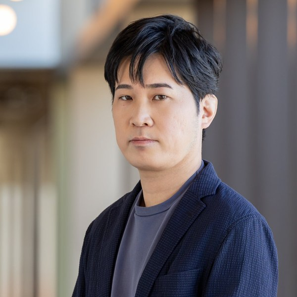

```{=html}
<div class="hero" style="background-image: url('files/banner.jpg');" role="img" aria-label="JOSAI HUB, Josai University"></div>

<div class="profile">
  <!-- 顔写真: files/face.jpg を置いたら、次の行の先頭と末尾のコメント記号を消す -->
  <!--  -->
  <h1 class="name">Shinji Matsumiya</h1>
  <p class="role">Assistant Professor, Faculty of Economics, Josai University</p>
  <p class="links">
    <a href="files/Matsumiya_CV.pdf">CV (PDF)</a>
    <a href="https://scholar.google.com/citations?user=6knm8P0AAAAJ">Google Scholar</a>
    <a href="https://orcid.org/0009-0003-4194-9378">ORCID</a>
    <a href="https://researchmap.jp/smatsumiya">researchmap</a>
    <a href="https://www.researchgate.net/profile/Shinji-Matsumiya-3">ResearchGate</a>
    <a href="mailto:smatsumiya@josai.ac.jp">Email</a>
  </p>
</div>
```

I am a sociologist of education working at the intersection of higher education policy and quantitative causal inference. My research asks how Japan's private-led higher education system responds to demographic decline, whether public subsidies and regulations achieve what they promise, and how these institutional changes shape educational inequality.

Before entering academia, I worked for fifteen years as an administrator at a private university, in student support and academic affairs. That experience shapes my questions about institutional finance, enrollment, and policy steering. I build original institution-level panel datasets and link them with social survey microdata, and I analyze them with methods for time-varying treatments and confounding: marginal structural models (IPTW/IPCW), g-methods, multilevel models, and age–period–cohort analysis.

## Research interests

- Private higher education and contraction under demographic decline
- Public subsidies, enrollment control, and institutional behavior
- Educational stratification and returns to college selectivity
- Causal inference with time-varying confounding

## Selected work

- A. Yonezawa, Y. Fan, R. Nakao, M. Murasawa, and **S. Matsumiya**. 2022. "Policy Debates and the Reality of the Research Productivity of National Universities in Japan." In *The Performance of Asian Higher Education*, ed. G. Croucher, C. Wang, and J. Yang, 100–113. Routledge.
- **S. Matsumiya.** 2026. "Exploring the Factors Determining Under-Enrollment in Private Universities: A Multi-Level Model of Region, University, and Time" (in Japanese). *The Japanese Journal of Educational Research* 93(1): 14–25.
- **S. Matsumiya**, R. Nakao, and Y. Fan. 2023. "Decentralization Trend Caused by the Policy of Tightening Private Universities' Capacity Management: A Reexamination Using Time-Series Data on Enrollment Rates" (in Japanese). *The Journal of Educational Sociology* 112: 169–190.

[All publications →](publications.qmd)

## Current projects

- **After Universal Access: Contraction Without Exit in Japan's Private Higher Education**
- **Human Capital or Signaling?** A comparative test of the college wage premium using survey data and university selectivity
- Rethinking the causal relationship between under-enrollment and bankruptcy of private universities (JSPS KAKENHI 24K16629, PI, 2024–2027)

## Background

- 2026–present: Assistant Professor, Faculty of Economics and Graduate School of Economics, Josai University
- 2025–2027: Visiting Researcher, Research Institute for Higher Education, Hiroshima University
- 2023–2026: Lecturer, Center for Higher Education, Shinshu University
- 2008–2023: University administrator, Kobe Gakuin University
- 2024: Ph.D. in Education, Hiroshima University

My name is pronounced *SHIN-jee Mah-tsoo-MEE-yah*.
